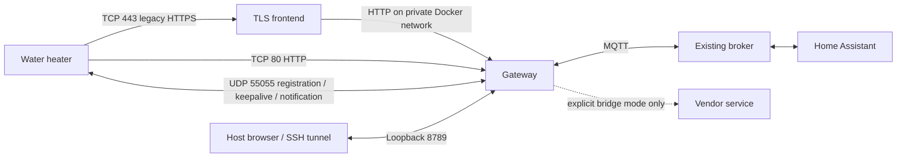

# Architecture

A single gateway instance learns one heater ID and selects one explicit device
profile. DNS rewrites point the heater's service and notification hosts to the
Docker host. The gateway is an endpoint replacement, not a DNS server.

## Modules

| File | Responsibility |
| --- | --- |
| `main.mjs` | Settings, services, serialized mutations, startup/shutdown |
| `http.mjs` | Heater-facing requests, captures, local routing, bridge observation |
| `local-service.mjs` | Observed lookup/metadata routes, local identity and reporting subscription |
| `ans-protocol.mjs`, `ans-local.mjs` | Signed registration, encrypted packets, keepalive/probe, bounded notifications and session restoration |
| `cloud.mjs` | Explicit upstream HTTP/UDP forwarding using an independent resolver |
| `controller.mjs`, `store.mjs` | Command lifecycle, reports/faults, connection versus freshness, persistence |
| `devices/`, `decoder.mjs`, `protocol.mjs` | Explicit model profile and verified packed-report/command formats |
| `hot-water-estimate.mjs` | Separately labeled experimental heuristic |
| `mqtt.mjs`, `discovery.mjs` | Retained reported state, non-retained commands, HA discovery |
| `admin.mjs`, `web/` | Loopback UI/API and setting changes |
| `journal.mjs` | Redacted or opt-in full private HTTP/UDP capture |

Commands are persisted before delivery, never automatically resent after an
interruption, and confirmed only by subsequent matching telemetry. Fault updates
never confirm a temperature command or make temperature telemetry fresh.

`/data/state.json` stores instance/device identity, latest reports, pending command
and fault state. Other private files hold runtime settings and resumable ANS state.
Keep the volume: this is not disposable cache. Mode changes restart the process,
but do not force the physical heater to adopt different keys or account state.

## Trust boundaries

The admin UI has no authentication and is loopback-only. A CSRF token protects
state-changing browser requests, not access from an untrusted network. Heater
TLS uses an old compatibility frontend and self-signed local certificate; isolate
that LAN-facing service. MQTT TLS retains normal certificate verification.
Device-ID binding is not a substitute for network isolation or a general-purpose
authentication scheme. Do not expose heater endpoints to the Internet.

Local mode does not construct an upstream resolver/client for normal device
operation. Bridge mode is explicit and uses the real cloud. Router-level egress
blocking is needed to prevent the appliance from bypassing DNS rewrites.
